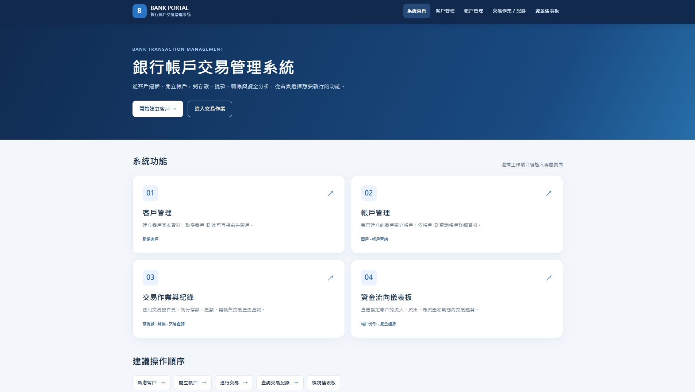
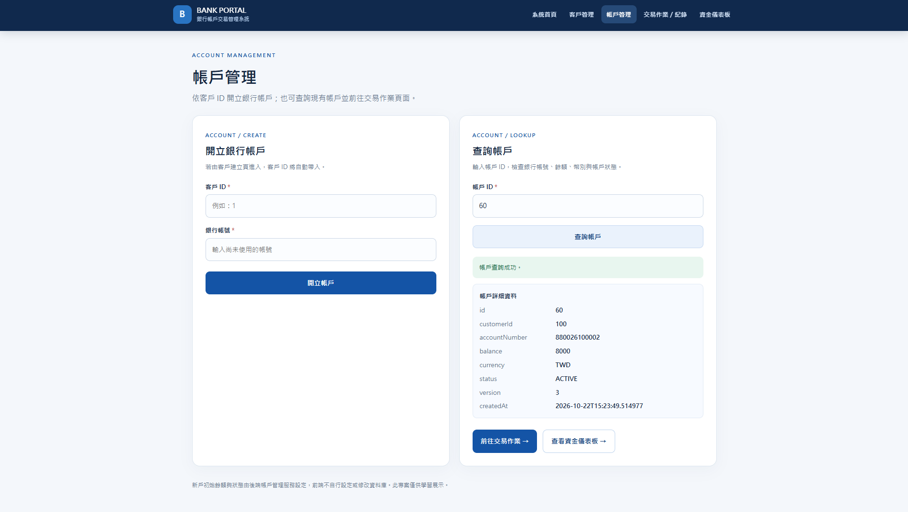
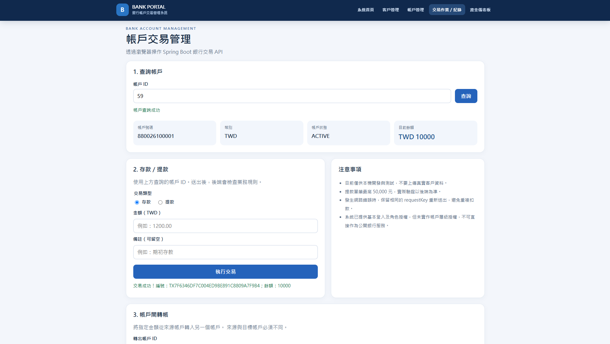
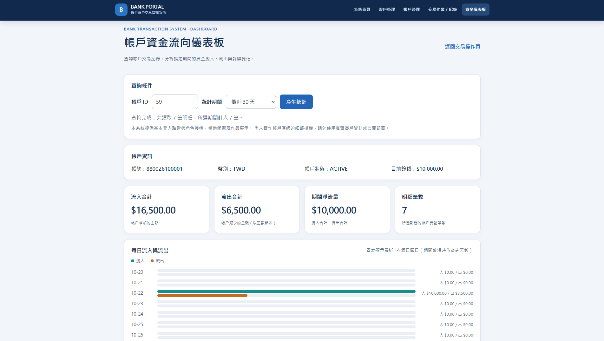
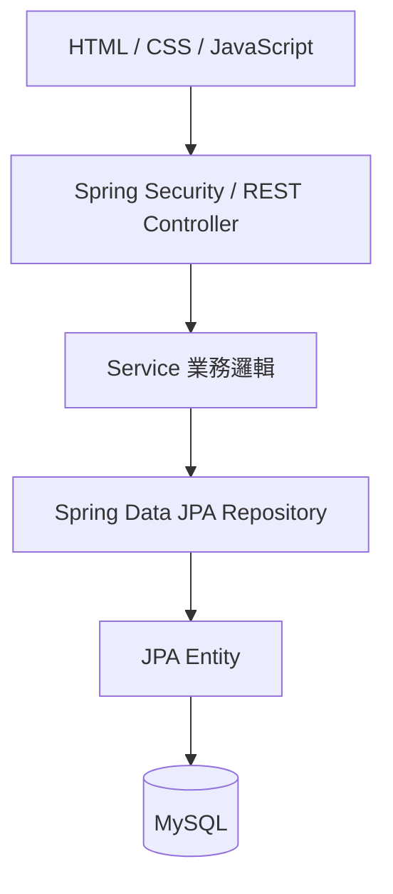

# 銀行帳戶交易管理系統 | Bank Transaction System

以 **Java、Spring Boot 與 MySQL** 開發的銀行帳戶與交易管理 Web 應用程式，提供客戶及帳戶管理、存提款、轉帳、交易紀錄查詢與資金流向儀表板。後端採用分層架構，透過 REST API 串接原生 JavaScript 前端，並使用 Spring Data JPA 管理資料存取。

本系統以模擬金融業務流程為設計範圍，不連接實際金融機構或進行真實資金移轉。

## 系統畫面

### 系統首頁



### 客戶與帳戶管理



### 銀行交易操作



### 資金流向儀表板



## 系統功能

| 功能 | 說明 |
| --- | --- |
| 客戶管理 | 客戶建立、查詢與狀態管理 |
| 帳戶管理 | 帳戶開立、查詢、狀態管理與餘額檢視 |
| 存款與提款 | 金額與帳戶狀態驗證、交易紀錄建立、餘額更新 |
| 帳戶轉帳 | 來源與目標帳戶驗證、交易處理與一致性控制 |
| 交易紀錄 | 帳戶交易歷史分頁查詢及單筆交易明細 |
| 資金流向儀表板 | 交易流入、流出、淨流量與近期紀錄呈現 |
| 登入與存取控制 | Spring Security 表單登入與角色授權 |

### 網頁入口

| 頁面 | 路徑 |
| --- | --- |
| 首頁 | `/bank/index.html` |
| 客戶管理 | `/bank/customers.html` |
| 帳戶管理 | `/bank/accounts.html` |
| 交易管理 | `/bank/transactions.html` |
| 綜合管理 | `/bank/management.html` |
| 資金流向儀表板 | `/bank/dashboard.html` |

## 技術架構

| 層面 | 技術 |
| --- | --- |
| 程式語言 | Java 25 |
| 後端框架 | Spring Boot 4.1.1、Spring Web MVC |
| 資料存取 | Spring Data JPA、Hibernate、MySQL |
| 安全與驗證 | Spring Security、Jakarta Bean Validation |
| 前端 | HTML、CSS、JavaScript |
| 建置與測試 | Maven、JUnit、Spring Boot Test |
| 開發環境 | Eclipse |



**主要設計：**

- **Controller**：處理 HTTP 請求、DTO 驗證與 API 回應。
- **Service**：執行客戶、帳戶及交易業務規則。
- **Repository / Entity**：使用 JPA 映射資料表並提供資料存取操作。
- **DTO**：定義 API 的請求及回應格式。
- **交易處理**：使用 `@Transactional`、帳戶鎖定、請求識別碼與交易明細記錄，支援資料一致性及重複請求控管。

### 資料庫設計

資料庫名稱為 `bank_transaction_db`，包含五張核心資料表：

| 資料表 | 用途 |
| --- | --- |
| `customers` | 客戶資料 |
| `accounts` | 銀行帳戶及餘額 |
| `transaction_requests` | 交易請求與識別碼 |
| `bank_transactions` | 交易主紀錄 |
| `account_entries` | 帳戶金額異動明細 |

建表腳本：[database/schema.sql](database/schema.sql)

### UML 圖

- [系統類別依賴圖](docs/uml/01_系統類別依賴圖.png)
- [資料實體關聯圖](docs/uml/02_資料實體關聯圖.png)
- [轉帳流程圖](docs/uml/03_轉帳流程圖.png)

## REST API

| HTTP 方法 | 路徑 | 功能 |
| --- | --- | --- |
| `GET` | `/api/customers` | 客戶清單 |
| `POST` | `/api/customers` | 建立客戶 |
| `GET` | `/api/customers/{id}` | 查詢客戶 |
| `GET` | `/api/customers/{id}/accounts` | 查詢客戶帳戶 |
| `PATCH` | `/api/customers/{id}/status` | 修改客戶狀態 |
| `GET` | `/api/accounts` | 帳戶清單 |
| `POST` | `/api/accounts` | 開立帳戶 |
| `GET` | `/api/accounts/{id}` | 查詢帳戶 |
| `PATCH` | `/api/accounts/{id}/status` | 修改帳戶狀態 |
| `POST` | `/api/transactions/deposits` | 存款 |
| `GET` | `/api/transactions/deposits/{transactionId}` | 查詢存款交易 |
| `POST` | `/api/transactions/withdrawals` | 提款 |
| `GET` | `/api/transactions/withdrawals/{transactionId}` | 查詢提款交易 |
| `POST` | `/api/transfers` | 帳戶轉帳 |
| `GET` | `/api/accounts/{accountId}/transactions` | 分頁交易紀錄 |
| `GET` | `/api/accounts/{accountId}/transactions/{transactionId}` | 單筆交易明細 |
| `GET` | `/api/hello` | 系統資訊 |

API 使用 Spring Security 保護，寫入請求須符合應用程式的認證與 CSRF 規則。

## 安裝與執行

### 環境需求

- JDK 25
- Maven
- MySQL 8.x

### 1. 建立資料庫

使用 MySQL 執行：

```sql
CREATE DATABASE IF NOT EXISTS bank_transaction_db
  CHARACTER SET utf8mb4 COLLATE utf8mb4_0900_ai_ci;
```

再以 `bank_transaction_db` 為預設資料庫執行 `database/schema.sql`。

本專案使用 `spring.jpa.hibernate.ddl-auto=validate` 檢查既有資料庫結構，不會自動建立資料表。

### 2. 設定本機密碼

將 `config/local-secrets.properties.example` 複製為 `config/local-secrets.properties`，設定下列屬性：

```properties
BANK_DB_PASSWORD=<database-password>
BANK_DEMO_ADMIN_PASSWORD=<admin-password>
BANK_DEMO_TELLER_PASSWORD=<teller-password>
```

此設定檔由 `application.properties` 在啟動時讀取，並透過 `.gitignore` 排除版本追蹤。資料庫預設連線位址為 `localhost:3306`，資料庫使用者設定於 `application.properties`。

### 3. 建置

在專案根目錄執行：

```bash
mvn clean package
```

### 4. 啟動服務

在含有 `pom.xml` 與 `config/` 的專案根目錄執行：

```bash
java -jar target/bank-transaction-system-1.0.0.jar
```

網站入口：[http://localhost:8080/bank/index.html](http://localhost:8080/bank/index.html)

登入帳號為 `admin` 或 `teller`；密碼由本機外部設定檔提供。啟動前請確認 MySQL 服務已運行。

## 測試

使用 Maven 執行：

```bash
mvn clean test
```

測試程式涵蓋資料驗證、Service 業務規則、資料庫與 API 整合，以及靜態資源等。`ApiSmokeTest` 另需執行中的服務與測試環境參數，適用於整合環境下的基本 HTTP 檢查。

## 適用範圍

此系統用於軟體架構、金融交易流程及資料庫交易控制的技術展示，不適用於實際金融服務；正式上線仍需完整的身分授權、安全防護、操作稽核與部署測試。
